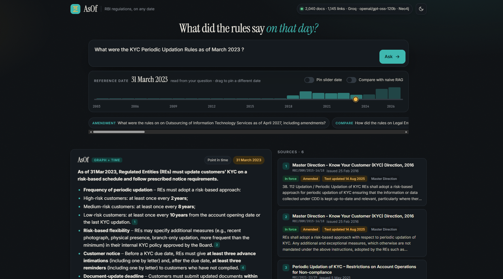
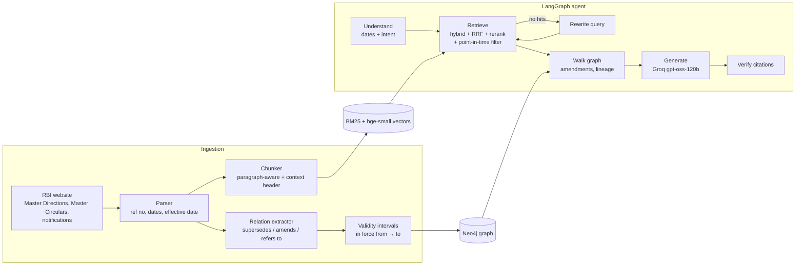

# AsOf — a time-aware GraphRAG copilot for RBI regulations

> **Ask what the rules were on any date.** AsOf answers from the version of an RBI regulation that was
> actually in force on that date, follows the chain of amendments, and cites every claim.

**Live demo:** https://3rutaofnk434ujt7w7rgbyzb3u0yvcej.lambda-url.ap-south-1.on.aws/
<sub>(serverless on AWS Lambda; if nobody has used it for a while, the first page load can take up to a minute)</sub>

Regulations change constantly. A circular from 2019 may have been amended in 2020 and replaced in 2022.
A standard RAG pipeline retrieves by similarity, so it happily mixes the 2019, 2020 and 2022 versions and
gives a confident answer that was never true on any single day. **AsOf treats time as a first-class filter**
and treats "X amends / replaces Y" as graph edges the agent can walk.



## What it does

| Question type | Example | What happens |
|---|---|---|
| Point in time | *"What were the gold loan LTV rules as of March 2021?"* | Retrieves only documents in force on 31 Mar 2021, then adds any amendments effective by then |
| Comparison | *"How did KYC updation change between 2020 and 2024?"* | Retrieves separately for both dates and asks the LLM to list concrete differences |
| History | *"Show the history of the rules on internal ombudsman"* | Walks the supersession chain in the graph and orders versions in time |
| Current | *"What are the current rules on …?"* | Same pipeline with today as the reference date |

## How it works



**Key design decisions** (details in [docs/ARCHITECTURE.md](docs/ARCHITECTURE.md)):

1. **Relations come from the documents themselves.** Three signals: cue phrases next to a reference
   number (*"in supersession of"*, *"in partial modification of"*), the *"list of circulars repealed"*
   annex at the end of Master Directions, and yearly re-issues of Master Circulars with the same title.
2. **Validity intervals.** Each document is in force on `[effective_date, date its replacement took effect)`.
   The retriever masks out everything else *before* ranking, so stale text never reaches the LLM.
3. **Amendments are pulled in by the graph, not by similarity.** An amending circular often shares few
   words with the question ("In partial modification of para 3…"), so the agent adds it by following `AMENDS` edges.
4. **Dates are parsed with rules, not the LLM.** Dates are the one thing the system cannot afford to get wrong.
5. **A benchmark that labels itself.** Every supersession edge yields "just before" and "just after" questions
   with a known correct document, so the evaluation set grows with the corpus.

## Results

Run `python -m asof.cli eval` after building the index; it writes `data/eval/results.md`.
Paste the table here:

<!-- RESULTS_TABLE -->
Corpus: ~2,000 RBI Master Directions, Master Circulars and circulars (2018 → 2026), 1,145 extracted links.
Benchmark: 300 questions generated from the amendment graph, k = 6.

| System | Hit@6 | MRR | Stale@6 (lower is better) | Amendment recall | Latency |
|---|---|---|---|---|---|
| Naive RAG (vector only) | 73.0% | 0.404 | 60.8% | 22.9% | 28 ms |
| Hybrid RAG (BM25 + vector + rerank) | 79.3% | 0.464 | 57.0% | 25.7% | 1.2 s |
| **AsOf** (hybrid + time filter + graph) | **95.0%** | **0.815** | **0.4%** | **98.6%** | 1.5 s |

Retrieval latency measured on a laptop CPU (no GPU), excluding the LLM call.

*Stale@k* is the share of retrieved documents that were **not in force** on the question's date.

## Quick start (Windows)

Full, step-by-step instructions: **[docs/SETUP_GUIDE.md](docs/SETUP_GUIDE.md)**. Short version:

```powershell
python -m venv .venv; .\.venv\Scripts\Activate.ps1
pip install -r requirements.txt
pip install -e .
copy .env.example .env          # add GROQ_API_KEY (and Neo4j AuraDB details)

python -m asof.cli fetch --source md                       # Master Directions
python -m asof.cli fetch --source mc                       # Master Circulars
python -m asof.cli fetch --source ids --start 11300 --end 13720   # circulars 2018 → 2026 (~1 hour)
python -m asof.cli build
python -m asof.cli eval
python -m asof.cli serve        # http://127.0.0.1:8000
```

Or run everything at once: `powershell -ExecutionPolicy Bypass -File scripts\quickstart.ps1`

## Project layout

```
src/asof/
  ingest/      fetch_rbi.py (downloader) · parse.py · relations.py · chunker.py
  graph/       store.py (Neo4j + NetworkX backends) · temporal.py (validity intervals)
  retrieval/   bm25.py · embeddings.py (bge-small) · rerank.py (MiniLM cross-encoder) · hybrid.py (RRF + time filter)
  agent/       query.py (date/intent parser) · nodes.py · graph.py (LangGraph) · llm.py (Groq) · prompts.py
  eval/        questions.py (graph-generated benchmark) · run_eval.py (metrics + baselines)
  web/         server.py (Starlette API) · static/ (UI: time slider, version timeline, source drawer)
  cli.py       fetch · build · ask · eval · audit · serve
tests/         end-to-end tests on a small synthetic corpus (no network or API key needed)
```

## Tech stack

LangGraph · LangChain (Groq) · gpt-oss-120b / gpt-oss-20b on Groq · Neo4j (AuraDB) · sentence-transformers
(`BAAI/bge-small-en-v1.5`, `cross-encoder/ms-marco-MiniLM-L-6-v2`) · BM25 · Reciprocal Rank Fusion · Starlette/Uvicorn ·
vanilla JS front-end · Docker · pytest

## Limitations

- RBI updates some Master Directions in place; the website only shows the latest text, so older
  in-place revisions are not recoverable from the site.
- Relation extraction is rule-based. Run `python -m asof.cli audit` and label a sample to measure its precision.
- Not legal advice. Always confirm against the circular on rbi.org.in.
